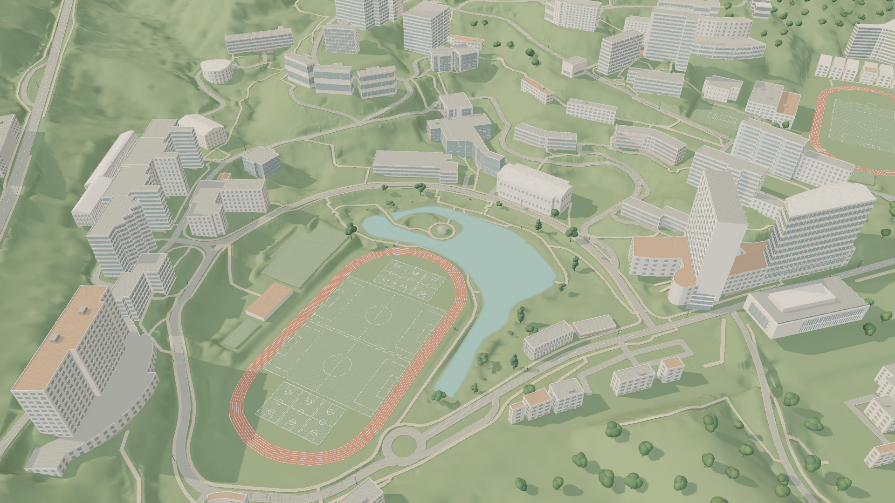
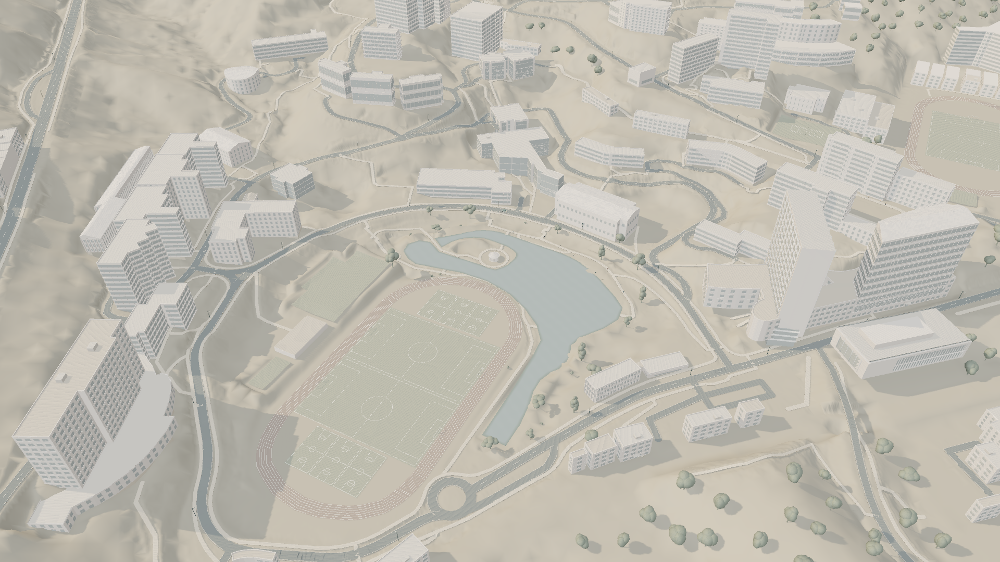
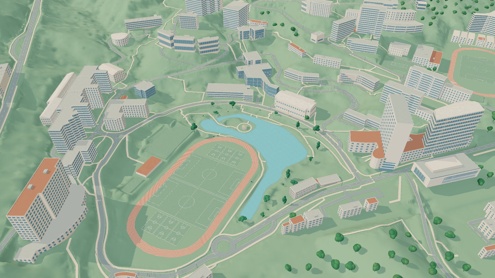

# CUHK Digital Campus · 香港中文大学数字校园

基于现有 Blender 校园模型和 Three.js 的交互式校园网页，包含昼夜、建筑分区加载、地点搜索、食堂和公交站、未圆湖生态样板，以及三种可切换的沙盘风格示例。

## 运行

需要 Node.js 22.12 或更新版本。首次克隆前安装 Git LFS，以取得 Blender 主文件：

```sh
git lfs install
git clone https://github.com/HainaHuang729/cuhk-digital-campus.git
cd cuhk-digital-campus/cuhk-campus-web
npm ci
npm run dev
```

浏览器打开 http://127.0.0.1:5178/，等待加载后进入校园。运行网页不需要 Blender；网页所需 GLB 已包含在仓库中。仅运行网页时也可跳过 Blender 大文件下载。

```sh
npm test
npm run build
```

`dist` 输出到 `cuhk-campus-web/dist`。静态资源使用根路径，部署到网站根目录。详细操作见 [网页说明](cuhk-campus-web/README.md)。

## 三种风格示例

Explore → 风格示例，可切换 A 暖纸沙盘、B 白模建筑、C 清新彩色或恢复原始材质。“未圆湖沙盘”按钮切换到样板机位。

| A · 暖纸沙盘 | B · 白模建筑 | C · 清新彩色 |
| --- | --- | --- |
|  |  |  |

## 文件范围

- `cuhk-campus-web/`：网页源码、测试、锁定依赖和全部网页运行资源。
- `artifacts/cuhk/CUHK_shaw_science_corrected.blend`：当前 Blender 主模型，由 Git LFS 管理。
- `artifacts/cuhk/`：建模和导出脚本、几何数据、政府参考层与生态来源说明、样板截图。旧版 Blender、UE5 工程、原始城市级下载数据及历史大图没有收录。

源脚本中的本机路径可能需要按环境调整；网页已包含预生成资源，直接运行不依赖离线重建。没有附带第三方数据的额外授权，使用范围以原来源条款为准。

## 来源和限制

地形使用香港政府 CEDD LiDAR 派生资料；建筑、道路及名称包含 © OpenStreetMap contributors 数据；局部建筑参考校方公开照片。项目保留相关来源说明和链接，不代表中大官方模型，也不用于实测或实时导航。生态兴趣点是资料支持的近似观察区域，不是全校精确普查或实时监测。

风格示例为现有模型的运行时材质处理，不改变源 Blender/GLB 几何。当前画面仍有局部几何与细纹瑕疵，尚未完成逐栋精修或手机真机性能验证。
